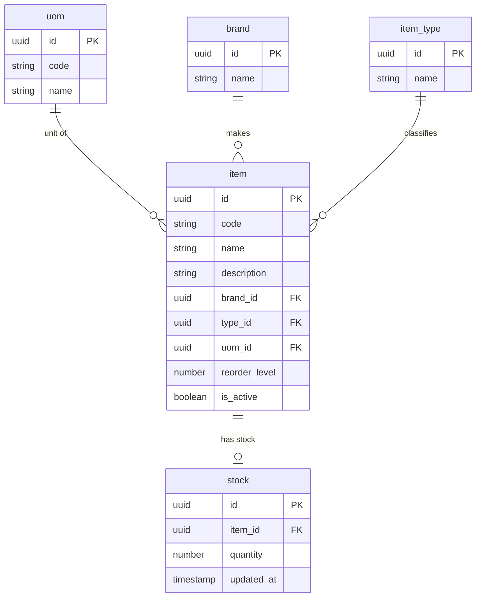
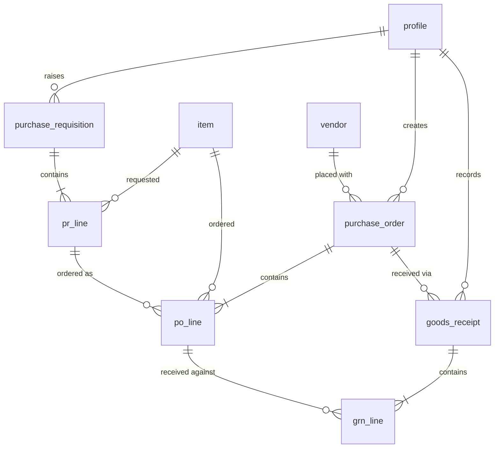

# Inventory Management System: Flow and Design Overview

ISMO Biophotonics. Stack: **React (frontend) + Supabase (database, login, API)**.

**Status:** requirements and data model agreed. The database schema (SQL), security rules and screens are **not built yet**. This document is the shared understanding the build will follow.

---

## 1. What the system does

It manages how items are set up, requested, ordered and received:

1. The **admin** keeps the item catalogue and the current stock numbers.
2. A **requestor** (someone who uses the items) raises a **Purchase Requisition (PR)** for what they need.
3. A **manager** reviews the PR line by line, then turns the accepted lines into **Purchase Orders (PO)** for vendors.
4. When the vendor delivers, a **Goods Receipt (GRN)** is recorded together with the vendor's invoice details.
5. When everything accepted on a PR has arrived, the PR is marked **fulfilled** automatically.

```
Admin: Item Master + Stock
        │ (items to choose from)
        ▼
Requestor ──► PR (many items) ──► Manager reviews each line
                                    accept / reject / edit quantity
                                              │
                                              ▼
                                  PO(s), one per vendor ──► sent to vendor
                                              │
                                              ▼
                              GRN(s) + invoice details (partial allowed)
                                              │
                                              ▼
                         PR marked FULFILLED automatically
```

## 2. Scope

**In scope:** Item Master (units, brands, types, items, stock), PR, PO, GRN.

**Out of scope (by decision):**
- Tracking usage or issuing stock to people. Stock never goes down automatically.
- Tracking payments. Payment terms are only written on the PO.
- Batch numbers, expiry dates, serial numbers.
- Linking items to specific vendors (the manager picks any vendor on the PO).
- Stock history or an audit trail of stock edits.

## 3. Roles (proposed, confirm with the team)

| Role | Can do |
|---|---|
| **Admin** | Manage units, brands, types, items, vendors. Edit stock. View everything. Enter GRNs. |
| **Requestor** | Create PRs. See only their own PRs. View items. |
| **Manager** | Review PRs (accept, reject, edit quantity). Create POs. Enter GRNs. View everything. |

Login and passwords are handled by Supabase. Each user has a profile with a role, and the database enforces what each role may see or change.

## 4. Modules and their purpose

| Module | Purpose |
|---|---|
| **Units (`uom`)** | Units of measure: PCS, BOX, KG, ML. Every item has one. |
| **Brands (`brand`)** | Who makes the item. |
| **Item types (`item_type`)** | Groups items: consumable, reagent, equipment, etc. |
| **Items (`item`)** | The catalogue. One record per product. |
| **Stock (`stock`)** | The current quantity of each item. Edited by the admin only. |
| **Vendors (`vendor`)** | Who we buy from, with address and GST number, so the PO is readable by them. |
| **PR** | A request from a requestor. Header plus one line per item. |
| **PO** | The order sent to a vendor. Header plus one line per item. |
| **GRN** | The record of goods arriving, with invoice details. Header plus one line per item received. |

## 5. Data model

### Item Master



| Table | Fields |
|---|---|
| `uom` | id, code, name |
| `brand` | id, name |
| `item_type` | id, name |
| `item` | id, code (unique), name, description, brand_id, type_id, uom_id, reorder_level, is_active |
| `stock` | id, item_id (one row per item), quantity, updated_at |
| `vendor` | id, name, address, gst_no, contact |

`reorder_level` is the quantity at which stock counts as low. `is_active` hides discontinued items without deleting them (old PRs and POs still need to point at them).

### PR, PO, GRN



| Table | Fields | Notes |
|---|---|---|
| `purchase_requisition` | id, pr_date, priority, requested_by, status | One per request. Priority applies to the whole PR (low / medium / high). |
| `pr_line` | id, pr_id, item_id, quantity, approved_quantity, status | `quantity` is what the requestor asked for and never changes. `approved_quantity` is what the manager allows. `status` is pending, accepted or rejected. |
| `purchase_order` | id, po_date, vendor_id, created_by, payment_terms, comments, status | One vendor per PO. `payment_terms` is plain text such as "50% advance, 50% on delivery". |
| `po_line` | id, po_id, pr_line_id, item_id, price, quantity, gst, arrival_date | Price, GST and expected arrival date are per line. `pr_line_id` links back to the PR line it came from. |
| `goods_receipt` | id, po_id, received_date, invoice_no, invoice_date, comments, received_by | Deliberately generic and small. |
| `grn_line` | id, grn_id, po_line_id, received_quantity | What arrived for each PO line. |
| `profile` | id, full_name, role | The users, managed through Supabase login. |

### Why header and line tables
A PR, PO or GRN can contain several different items. The **header** holds what is true once (date, vendor, who raised it). Each **line** holds one item and its numbers. Without lines, one request would need repeated columns (item1, item2, ...) or repeated header rows.

## 6. Statuses (proposed, adjust as needed)

| Record | Statuses |
|---|---|
| PR line | `pending` → `accepted` or `rejected` |
| PR | `submitted` → `reviewed` (every line decided) → `ordered` (every accepted line is on a PO) → `fulfilled` (every accepted line fully received). If every line is rejected, the PR is `rejected`. |
| PO | `open` → `partially_received` → `received` |
| GRN | no status; it is a record of an event |

## 7. Business rules

1. **Stock is edited only by the admin.** A GRN never changes stock, and nothing reduces it. The admin updates stock by hand after goods arrive.
2. A PR needs **at least one line**.
3. The manager decides **line by line**: accept, reject, or change `approved_quantity`. The requestor's original `quantity` is kept for the record.
4. Only **accepted** lines can be put on a PO, and never for more than the approved quantity.
5. A PO belongs to **one vendor**. One PR can therefore become **several POs**, one per vendor.
6. A PO can be received through **several GRNs** (partial deliveries). A GRN line records how much of a PO line arrived.
7. **Auto-fulfil:** when, for every accepted line of a PR, the total received equals the approved quantity, the PR becomes `fulfilled` without anyone marking it.
8. Requestors see **only their own PRs**. Managers and admin see all.
9. The vendor invoice details are entered on the GRN. Payment is not tracked.

## 8. Worked example

A requestor raises one PR with four items:

| Item | Requested |
|---|---|
| Dye | 10 bottles |
| Filters | 5 boxes |
| Gloves | 20 pairs |
| Cuvettes | 50 pieces |

**Manager review:** Dye accepted (10). Filters accepted but changed to 4. Gloves rejected. Cuvettes accepted (50).

**Orders:** Dye and Filters come from Vendor X, so they go on PO-1 (payment terms "50% advance, 50% on delivery"). Cuvettes come from Vendor Y, so they go on PO-2.

**Deliveries:**
- GRN-1 on PO-1: 6 Dye arrive, invoice INV-77 recorded. PO-1 is `partially_received`.
- GRN-2 on PO-1: 4 Dye and 4 Filters arrive. PO-1 is `received`.
- GRN-3 on PO-2: 50 Cuvettes arrive. PO-2 is `received`.

**Result:** every accepted line is fully received (Dye 10, Filters 4, Cuvettes 50; the rejected Gloves don't count), so the PR becomes `fulfilled` automatically. The admin then updates stock by hand.

## 9. Design decisions and trade-offs

| Decision | Why | Trade-off |
|---|---|---|
| Separate tables for units, brands, types, stock | Clean, no repeated text, easy to manage | A few more tables to join |
| Stock is a single number edited by the admin | Matches how the team works; simplest to build | No history; stock can drift from what was received |
| `po_line` links to `pr_line` | Needed for auto-fulfil and traceability | A PO can combine lines from different PRs for the same vendor. Allowed for now |
| `po_line` also stores `item_id` | Matches the agreed PO fields; easy to read | Duplicates what `pr_line` already implies, so the build must keep them consistent |
| `approved_quantity` separate from `quantity` | Keeps the requestor's original request | One extra column |
| Payment terms as text | Enough for the vendor to understand | Cannot report on paid or unpaid |
| No item–vendor link | Simpler; manager has freedom | Manager must know who sells what |
| Priority on PR header | One choice per request | Cannot mark one item more urgent than another |

## 10. Open points to confirm with the team

1. **Who enters the GRN and invoice?** Assumed admin and manager.
2. **GST:** store as a percentage rate (e.g. 18) or as an amount?
3. **Can one PO combine items from different PRs** for the same vendor?
4. **Over-receiving:** may a GRN record more than was ordered? Assumed no.
5. **Who manages vendors?** Assumed admin.
6. **Priority values:** assumed low / medium / high.
7. **Rejection reason:** should the manager write a reason when rejecting a line? Suggested, not yet in the model.
8. **Invoice amount:** should the GRN also store the invoice total? Currently only number and date.
9. **Cancelling or closing a PO** that will never be fully delivered.

## 11. Next steps

1. Confirm the open points above.
2. Write the database schema (SQL) for Supabase, matching this model.
3. Add the security rules per role (who can see and edit what).
4. Build the screens in this order: Item Master (units, brands, types, items, stock) → PR → PO → GRN.
5. Test the full flow end to end with the three roles.
